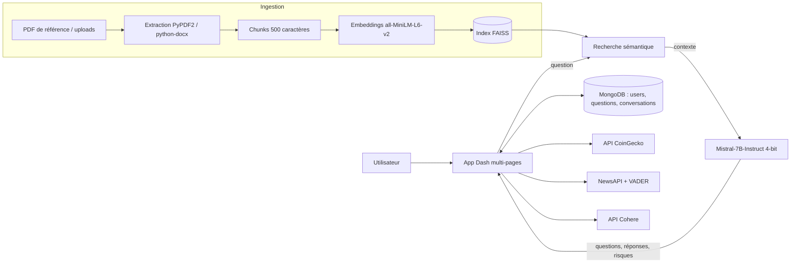

<div align="center">

# Crypto Due Diligence

**Plateforme web d'aide à la due diligence sur les actifs numériques, propulsée par un LLM local (Mistral-7B) et du RAG.**


</div>

---

## Sommaire

- [Présentation](#présentation)
- [Fonctionnalités](#fonctionnalités)
- [Architecture](#architecture)
- [Stack technique](#stack-technique)
- [Structure du projet](#structure-du-projet)
- [Installation](#installation)
- [Configuration](#configuration)
- [Lancement](#lancement)
- [Pistes d'amélioration](#pistes-damélioration)
- [Auteurs](#auteurs)

---

## Présentation

Une due diligence sur un projet crypto (token, exchange, protocole) demande de croiser beaucoup de sources : réglementation, risques ESG, conformité, aspects juridiques, état du marché et perception publique.

**Crypto Due Diligence** centralise ces étapes dans une seule application web :

- une **base de connaissances** construite à partir de ~18 rapports de référence (FATF, EY, WEF, Cravath, FTI…) indexés dans FAISS ;
- un **LLM Mistral-7B-Instruct quantifié en 4 bits** qui génère des questions de due diligence, détecte des risques dans les documents et répond aux questions en s'appuyant sur ce corpus (RAG) ;
- des **tableaux de bord marché et sentiment** pour compléter l'analyse documentaire par des données en temps réel.

## Fonctionnalités

### Banque de questions — `/banque_question`
- Upload de documents **PDF / DOCX**, découpage en chunks et indexation vectorielle.
- Génération automatique de questions de due diligence classées en trois catégories : **ESG**, **Compliance**, **Legal**.
- Génération d'une réponse pour chaque question via RAG sur le document.
- **Vérification de document** : le modèle joue le rôle d'un *senior compliance officer* et liste les risques, incohérences et points d'attention par catégorie.
- Persistance des questions/réponses dans MongoDB.

### Assistant RAG — `/banque_reponse`
- Chatbot qui cherche d'abord dans la banque de questions existante, puis bascule sur la recherche sémantique (FAISS + `all-MiniLM-L6-v2`) et la génération Mistral-7B.
- Upload de documents personnels : un **index FAISS dédié par document et par utilisateur**.
- Historique des conversations stocké par utilisateur.
- **Export du rapport en PowerPoint (.pptx)** généré automatiquement à partir de la conversation.

### Crypto Market — `/portfolio`
- Top cryptomonnaies via l'**API CoinGecko** : prix, capitalisation, volume, variation 24 h.
- **Sparklines** d'évolution des prix (Plotly), rafraîchissement automatique et cache local pour limiter les appels API.

### Crypto Social Media — `/social_media`
- Collecte des derniers articles sur le top 10 des cryptos via **NewsAPI**.
- **Analyse de sentiment VADER** sur chaque article.
- Score de signal combinant sentiment moyen et variation de prix 24 h → recommandation indicative *Investir / Attendre / Ne pas investir* avec justification.

### Chatbot généraliste — `/real-chatbot`
- Assistant conversationnel basé sur l'API **Cohere** pour les questions générales sur la crypto.

### Authentification
- Inscription / connexion avec mots de passe hachés (**bcrypt**), sessions Flask, et protection des pages sensibles.

## Architecture



## Stack technique

| Domaine | Outils |
|---|---|
| Front / Back | Plotly Dash (multi-pages), Dash Bootstrap Components, Flask sessions |
| LLM | Mistral-7B-Instruct-v0.1, Hugging Face Transformers, bitsandbytes (quantification NF4 4 bits) |
| RAG | Sentence-Transformers (`all-MiniLM-L6-v2`), FAISS (`IndexFlatL2`) |
| NLP | VADER Sentiment, Cohere |
| Données | CoinGecko API, NewsAPI, Pandas |
| Documents | PyPDF2, python-docx, python-pptx |
| Base de données | MongoDB (PyMongo), bcrypt |

## Structure du projet

```
Due_Diligence/
├── app.py                  # Point d'entrée : layout, navbar, auth, routage
├── model.py                # Chargement de Mistral-7B quantifié en 4 bits
├── generate_qa_bank.py     # Construit l'index FAISS à partir des PDF du corpus
├── faiss_index.bin         # Index vectoriel pré-calculé
├── text_chunks.npy         # Chunks de texte associés à l'index
├── PDF/                    # Corpus de rapports de référence (FATF, EY, WEF…)
├── assets/                 # CSS et logo
└── Pages/
    ├── home.py             # Page d'accueil
    ├── Banque.py           # Banque de questions + vérification de documents
    ├── chatbot.py          # Assistant RAG + export PPTX
    ├── portfolio.py        # Dashboard marché (CoinGecko)
    ├── social_media.py     # Actualités + sentiment + signal
    └── real-chatbot.py     # Chatbot Cohere
```

## Installation

### Prérequis
- Python 3.10+ (développé en 3.11)
- MongoDB en local sur `mongodb://localhost:27017/`
- **GPU NVIDIA avec CUDA recommandé** (~6 Go de VRAM) : la quantification 4 bits via bitsandbytes nécessite un GPU
- Un compte Hugging Face pour télécharger Mistral-7B

### Étapes

```bash
git clone -b Adam https://github.com/eya-sheikhrouhou/Due_Diligence.git
cd Due_Diligence

python -m venv .venv
source .venv/bin/activate        # Windows : .venv\Scripts\activate

pip install -r requirements.txt

huggingface-cli login            # accès au modèle Mistral
```

> Sous Linux, renommez le dossier `Pages/` en `pages/` : Dash cherche `pages/` par défaut et le système de fichiers est sensible à la casse.

### (Optionnel) Reconstruire l'index FAISS

L'index est déjà fourni. Pour le régénérer à partir des PDF :

```bash
cd PDF && python ../generate_qa_bank.py && mv faiss_index.bin text_chunks.npy ..
```

## Configuration

Clés nécessaires :

| Variable | Utilisée par | Où l'obtenir |
|---|---|---|
| `COHERE_API_KEY` | `/real-chatbot` | dashboard.cohere.com |
| `NEWSAPI_KEY` | `/social_media` | newsapi.org |
| `FLASK_SECRET_KEY` | sessions (`app.py`) | chaîne aléatoire |

Créez un fichier `.env` (non versionné) :

```env
COHERE_API_KEY=xxx
NEWSAPI_KEY=xxx
FLASK_SECRET_KEY=xxx
```

## Lancement

```bash
python app.py
```

Puis ouvrez **http://localhost:8050**. Le premier lancement télécharge Mistral-7B (~15 Go), ce qui peut prendre plusieurs minutes.

## Pistes d'amélioration

- Chunking sémantique avec chevauchement au lieu d'un découpage fixe de 500 caractères
- Passage à un modèle plus récent (Mistral-7B-Instruct v0.3 ou équivalent)
- Remplacer le score de signal heuristique par un modèle entraîné et backtesté
- Conteneurisation (Docker Compose : app + MongoDB)
- Tests automatisés et CI GitHub Actions

## Avertissement

Les recommandations affichées par l'application sont indicatives et ne constituent pas un conseil en investissement.

## Auteurs

Projet réalisé à **ESPRIT** en équipe.

- **Adam Hassen** — [GitHub](https://github.com/adam-hassen) · [LinkedIn](https://linkedin.com/in/adam-hassen-06922b170) · [Hugging Face](https://huggingface.co/adam5858)
- **Eya Sheikhrouhou** — [GitHub](https://github.com/eya-sheikhrouhou)
